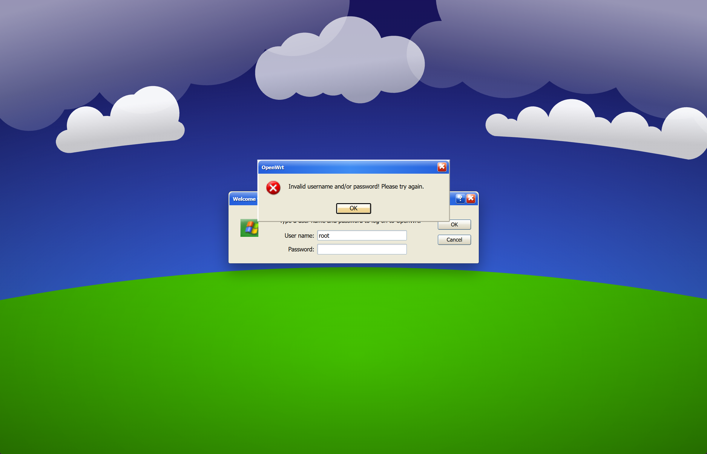
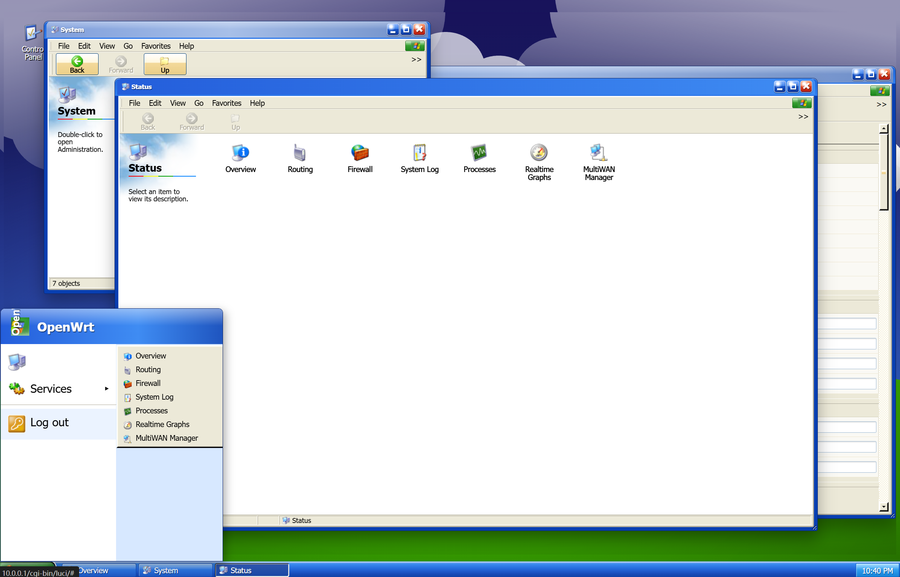

# luci-theme-xp

[中文文档](README.zh.md)

`luci-theme-xp` is an OpenWrt 24.x / LuCI theme that renders LuCI as a Windows XP Luna-style desktop. It uses XP blue title bars, a green Start button, a glossy taskbar, a Wikipedia/Wikimedia Commons Bliss-style wallpaper, and richer XP-era menu icons.

## Preview





## Features

- OpenWrt 24.x / LuCI ucode theme structure
- Windows XP Luna-inspired desktop, taskbar, window frames, title buttons, tabs, buttons, forms, and login dialog
- Wikipedia/Wikimedia Commons Bliss-style wallpaper bundled at `htdocs/luci-static/xp/wallpapers/wikipedia-bliss.svg`
- XP-style Start button and emblem PNGs sourced from the Windows XP Visual Guidelines taskbar reference and bundled at `htdocs/luci-static/xp/xp-start-button.png` and `htdocs/luci-static/xp/xp-start-emblem.png`
- Menu icons refreshed from the Windows XP icon library indexed by Windows Icon Archive and bundled under `htdocs/luci-static/xp/icons/menu/large/`
- Icon source notes are tracked in `htdocs/luci-static/xp/icons/menu/large/xp-icons-source.txt`
- Static assets served from `/luci-static/xp`
- LuCI theme registration name: `XP`
- Includes login page, header, footer, desktop icon, tables, forms, alerts, custom scrollbars, desktop windows, and mobile styles
- Can be verified and packaged locally as an `.ipk`

## Directory Layout

```text
htdocs/luci-static/xp/         # Static assets, CSS, icons, and window manager script
htdocs/luci-static/xp/wallpapers/ # Wikipedia/Wikimedia Commons wallpaper asset and source notes
ucode/template/themes/xp/      # LuCI ucode templates
root/etc/uci-defaults/            # Theme registration script
scripts/build_ipk.py              # Local .ipk package builder
tests/xp-theme-style.ps1          # Lightweight XP style regression checks
```

## Use In An OpenWrt Feed

Place this directory under a LuCI feed path, then run:

```sh
./scripts/feeds update -a
./scripts/feeds install luci-theme-xp
make menuconfig
```

Enable it under:

```text
LuCI -> Themes -> luci-theme-xp
```

After installation, switch to `XP` in the LuCI theme settings.

You can also switch the active LuCI theme with UCI:

```sh
uci set luci.main.mediaurlbase='/luci-static/xp'
uci commit luci
rm -f /tmp/luci-indexcache.*
rm -rf /tmp/luci-modulecache/
/etc/init.d/rpcd reload
```

## Local Verification

Run the style regression checks:

```powershell
powershell -ExecutionPolicy Bypass -File tests/xp-theme-style.ps1
```

The check confirms that the XP Luna tokens, Wikipedia wallpaper asset, taskbar gradient, rounded window titlebar, mobile token override, Start SVG, and XP icon source file are present.

## Local Packaging

This repository includes a buildroot-independent packaging script:

```sh
python scripts/build_ipk.py
```

The package version is controlled by `PKG_VERSION` in `scripts/build_ipk.py`; the current local package is `2026.05.16-r1`. The default artifact is written to `dist/`. You can also specify an output path:

```sh
python scripts/build_ipk.py --out dist/luci-theme-xp.ipk
```

## GitHub Actions

The workflow verifies the XP style checks and builds an `.ipk` artifact on pull requests, pushes, and manual dispatches. On push or manual dispatch, it also creates or updates a release for the current commit tagged as `ipk-<short-sha>`.
