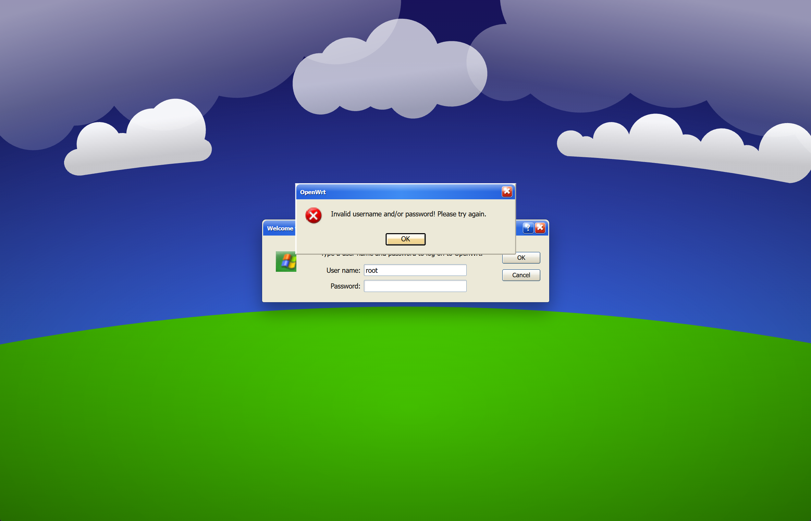
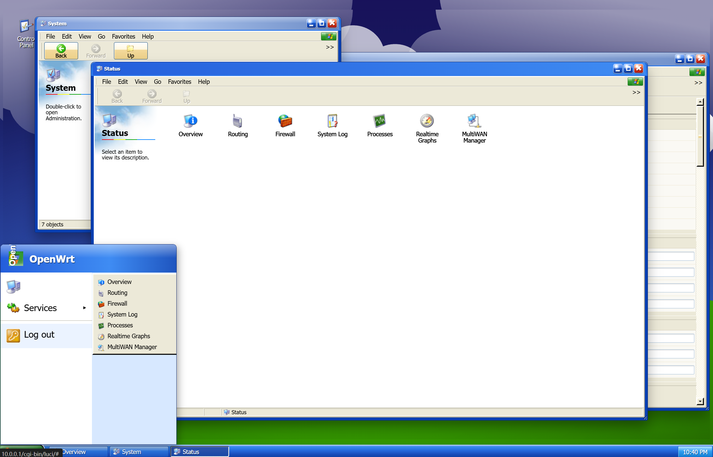

# luci-theme-xp

[English README](README.md)

`luci-theme-xp` 是一个面向 OpenWrt 24.x / LuCI 的 Windows XP Luna 风格主题。它使用 XP 蓝色标题栏、绿色 Start 按钮、高光任务栏、Wikipedia/Wikimedia Commons 上的 Bliss 风格壁纸，以及更接近 XP 时代的菜单图标。

## 预览





## 特性

- 适配 OpenWrt 24.x / LuCI ucode 主题结构
- Windows XP Luna 风格的桌面、任务栏、窗口边框、标题按钮、标签页、按钮、表单和登录窗口
- Wikipedia/Wikimedia Commons 的 Bliss 风格壁纸位于 `htdocs/luci-static/xp/wallpapers/wikipedia-bliss.svg`
- XP 风格 Start 按钮和徽标 PNG 来自 Windows XP Visual Guidelines 任务栏参考图，位于 `htdocs/luci-static/xp/xp-start-button.png` 和 `htdocs/luci-static/xp/xp-start-emblem.png`
- 菜单图标已替换为 Windows Icon Archive 索引的 Windows XP 图标库资源，运行时位于 `htdocs/luci-static/xp/icons/menu/large/`
- 图标来源说明位于 `htdocs/luci-static/xp/icons/menu/large/xp-icons-source.txt`
- 静态资源路径为 `/luci-static/xp`
- LuCI 主题注册名为 `XP`
- 包含登录页、页头、页脚、桌面图标、表格、表单、提示框、自定义滚动条、桌面窗口和移动端样式
- 支持本地验证并直接打包为 `.ipk`

## 目录结构

```text
htdocs/luci-static/xp/         # 静态资源、CSS、图标和窗口管理脚本
htdocs/luci-static/xp/wallpapers/ # Wikipedia/Wikimedia Commons 壁纸资源和来源说明
ucode/template/themes/xp/      # LuCI ucode 模板
root/etc/uci-defaults/         # 主题注册脚本
scripts/build_ipk.py           # 本地 .ipk 打包脚本
tests/xp-theme-style.ps1       # XP 样式轻量回归检查
```

## 在 OpenWrt Feed 中使用

将本目录放到 LuCI feed 路径下，然后执行：

```sh
./scripts/feeds update -a
./scripts/feeds install luci-theme-xp
make menuconfig
```

在 menuconfig 中启用：

```text
LuCI -> Themes -> luci-theme-xp
```

安装后，在 LuCI 主题设置中切换到 `XP`。

也可以通过 UCI 命令切换主题：

```sh
uci set luci.main.mediaurlbase='/luci-static/xp'
uci commit luci
rm -f /tmp/luci-indexcache.*
rm -rf /tmp/luci-modulecache/
/etc/init.d/rpcd reload
```

## 本地验证

运行样式回归检查：

```powershell
powershell -ExecutionPolicy Bypass -File tests/xp-theme-style.ps1
```

该检查会确认 XP Luna 变量、Wikipedia 壁纸资源、任务栏渐变、圆角窗口标题栏、移动端变量覆盖、Start SVG 和 XP 图标来源说明文件都存在。

## 本地打包

仓库内置了不依赖 OpenWrt buildroot 的打包脚本：

```sh
python scripts/build_ipk.py
```

默认产物输出到 `dist/luci-theme-xp_2026.05.16-r1_all.ipk`，版本由 `scripts/build_ipk.py` 中的 `PKG_VERSION` 控制。也可以指定输出路径：

```sh
python scripts/build_ipk.py --out dist/luci-theme-xp.ipk
```

## GitHub Actions

workflow 会在 pull request、push 和手动触发时运行 XP 样式检查并构建 `.ipk` artifact。push 或手动触发时，还会为当前提交创建或更新 `ipk-<short-sha>` 格式的 GitHub Release。
